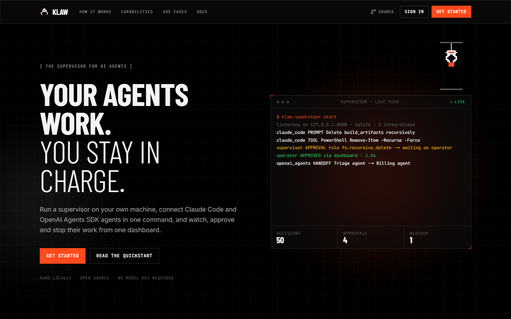
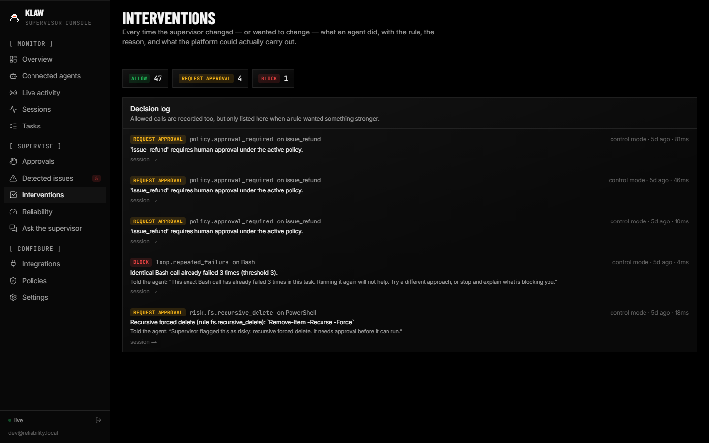
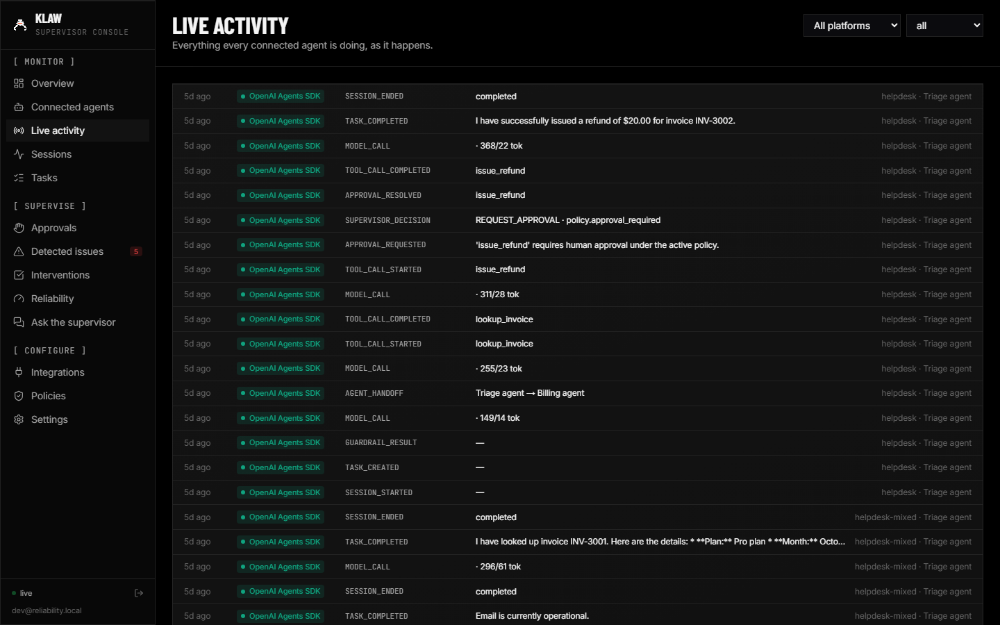

<div align="center">


# Klaw

**The supervisor for AI agents.**
Run it on your own machine, connect Claude Code and OpenAI Agents SDK agents in one command,
and watch, approve and stop their work from one dashboard.

[](https://github.com/samagragune/klaw/actions/workflows/ci.yml)
[](LICENSE)

[](https://klaw-supervisor.vercel.app)

[Website](https://klaw-supervisor.vercel.app) · [Quickstart](https://klaw-supervisor.vercel.app/docs/quickstart) · [Docs](https://klaw-supervisor.vercel.app/docs) · [Contributing](CONTRIBUTING.md)



</div>

---

## Why Klaw

Agents now run shell commands, move money and edit code on their own. Watching a trace afterwards
doesn't stop the recursive delete that already ran. Klaw sits at the point of action:

- **It catches** loops that go nowhere, risky operations (recursive deletes, force-pushes,
  dropped tables, `curl | sh`, credential files), stalls, runaway budgets, and answers that
  miss the task.
- **It acts** within your policy and each platform's real abilities: refuse a call with a reason
  the agent reads, hold it for a human (approve from your phone), send unfinished work back,
  stop or pause.
- **It explains itself.** Every decision is stored with its rule, reason, and what the platform
  could actually carry out. Every agent gets a reliability score from a published formula.
- **It stays yours.** The supervisor runs on your machine with one SQLite file. The hosted
  dashboard is a static app in your browser that talks to *your* supervisor; nothing passes
  through anyone else.

## Quickstart

```bash
# 1. Run the supervisor (Python 3.11+). It creates its own database and secret.
pip install "git+https://github.com/samagragune/klaw.git#subdirectory=backend"
klaw-supervisor start
```

2. Open **[klaw-supervisor.vercel.app](https://klaw-supervisor.vercel.app)** → *Get started*.
   The supervisor address should read `http://127.0.0.1:8000`; allow "access to apps on this
   device" if your browser asks.
3. **Integrations → Claude Code → Create key**, then in the project to supervise:

```bash
pip install "git+https://github.com/samagragune/klaw.git#subdirectory=companion"
klaw-companion setup --api-url http://127.0.0.1:8000 --key rl_int_…
```

Start Claude Code there; the session appears on the dashboard within seconds.
For an OpenAI Agents SDK app, one line changes:

```python
from klaw.integrations.openai_agents import AgentsSupervisor

supervisor = AgentsSupervisor(app_name="support-bot")
result = await supervisor.run(triage_agent, user_input)   # instead of Runner.run
```

## What it looks like

| Overview across platforms | A risky command held for approval |
|---|---|
|  |  |
| **Every decision, and why** | **Live activity from every agent** |
|  |  |

## Platforms

| | Claude Code (hooks) | OpenAI Agents SDK | Python SDK |
|---|---|---|---|
| Sessions, prompts, tool calls, sub-agents, answers | ✓ | ✓ | ✓ |
| Model calls and tokens | ✓ (from local transcript) | ✓ | ✓ |
| Block a tool call with a reason | ✓ | ✓ | ✓ |
| Hold for human approval | ✓ | ✓ | — |
| Answer the platform's own permission prompts | ✓ | — | — |
| Send unfinished work back | ✓ | ✓ | — |
| Stop | ✓ | ✓ | ✓ |
| Pause / resume | — | ✓ | ✓ |

Klaw says plainly what each platform can't do — see [Limitations](https://klaw-supervisor.vercel.app/docs/limitations).
Any other platform can connect through the open [event protocol](https://klaw-supervisor.vercel.app/docs/protocol).

## How it works

```
 your machine                                              your browser
┌──────────────────────────────────────────┐            ┌────────────────────────┐
│ Claude Code ──hooks──► klaw-companion ─┐ │            │ klaw-supervisor.       │
│ Agents SDK app ──► AgentsSupervisor ───┼─┼──events──► │ vercel.app (static UI) │
│ Python agent ──► klaw SDK ─────────────┘ │  decisions │                        │
│                     ▲                    │ ◄───────── │  talks directly to     │
│              klaw-supervisor             │            │  127.0.0.1:8000        │
│   rules · policies · approvals · SQLite  │ ◄──────────┤                        │
└──────────────────────────────────────────┘            └────────────────────────┘
```

Adapters are thin: they translate platform events into one protocol and turn decisions back into
platform actions. All rules, detection and history live in the supervisor. Every adapter **fails
open** — if the supervisor is down, agents keep working and queue their events.

## Repository layout

| Path | What |
|---|---|
| [`backend/`](backend) | `klaw-supervisor`: FastAPI + SQLAlchemy. Protocol, detectors, risk rules, decisions, approvals, evaluator. |
| [`companion/`](companion) | `klaw-companion`: Claude Code hook (stdlib only) and setup CLI. |
| [`sdk/`](sdk) | `klaw`: Python SDK and the OpenAI Agents SDK adapter. |
| [`dashboard/`](dashboard) | Next.js website: landing, docs, and the operator console. |
| [`integrations_tests/`](integrations_tests) | Live tests against real Claude Code sessions and Agents SDK runs. |
| [`docs/`](docs) | Integration guide, deployment notes, design history. |

## Development

```bash
python -m venv .venv && . .venv/bin/activate          # Windows: .venv\Scripts\activate
pip install -e "./backend[dev]" -e "./sdk[dev]" -e ./companion
pytest backend/tests sdk/tests companion/tests -q        # 138 tests

cd dashboard && npm ci && npm run dev                    # http://localhost:3000
```

Copy [`.env.example`](.env.example) to `.env` for local development settings.
See [CONTRIBUTING.md](CONTRIBUTING.md) for the workflow, and the live tests in
[`integrations_tests/`](integrations_tests) for checking changes against real agents.

## Security

Please report vulnerabilities privately — see [SECURITY.md](SECURITY.md).

## License

[MIT](LICENSE)
